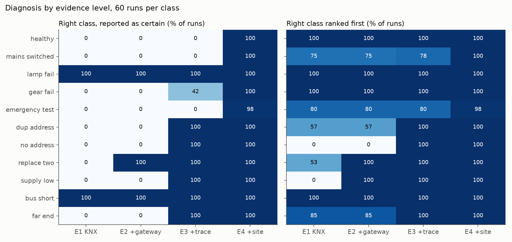

# knx-dali-gateway-failure-reports

Which lamp and driver failure reports of a KNX/DALI gateway can be trusted, from which
evidence, and how long a real failure stays unreported.

## In plain words

A gateway connects up to 64 lamp drivers on one DALI line to a KNX building system.
It asks every driver in turn whether it is fine and tells KNX when one is not.
Some of its alarms are false, some real failures come late, and some never come.
I built a simulated line, broke it in ten ways and checked which evidence tells the causes apart.
The KNX alarms alone prove only two of them; a recording of the DALI line proves seven, the site plan the rest.

**Simulated study, no hardware.** No recording from a real installation was used. The
DALI standard (IEC 62386) itself was not read, because it is not free: every protocol
fact is taken from openly readable manufacturer documentation, listed with what was taken
from it in [docs/SOURCES.md](docs/SOURCES.md). Every number below comes from
`results/summary.json`, written by `scripts/run_all.py`, and is checked against it by
`scripts/check_readme_numbers.py`.

## The question

A KNX/DALI gateway tells the KNX side that a lamp or a driver has failed, or stays silent
when one really has, or cannot find a driver after commissioning. Which causes can be told
apart with certainty, from which evidence, and how long can a real failure go unreported?

## The answer

Tested on 660 randomised virtual installations (8 to 64 control gear on one DALI line, one
gateway with integrated supply, 30 minutes of operation each), each with one of 10 injected
faults or none. The diagnosis engine sees one of four evidence levels: E1 the failure
objects on KNX, E2 plus the gateway's own diagnostics, E3 plus a DALI bus trace with a short
probe, E4 plus site facts (switched circuits, emergency test plan, wiring, supply rating).

1. **The KNX failure objects prove two causes; nothing wrong was ever called certain.** From
   E1 only a lamp failure (status bit 1) and a bus short are certain, both in 100 % of the
   runs. A gear added without a short address and an overloaded supply leave no failure
   object at all: 0 % ranked first at E1. Over all four levels the engine gave 1404
   "certain" verdicts and 0 of them were wrong. While a bus short lasts, nothing else is
   reported: 0 of 28 lamp failures that happened during a short reached any level.

2. **One extra piece of evidence separates the look-alikes, and its physics is simple.** A
   wired-AND bus can only add low levels. Two gear answering one short address therefore
   leave a low where a valid frame must be high; a far gear on a long thin cable leaves a
   low that does not reach the 4.5 V receiver threshold. With the bus trace (E3) duplicate
   addresses go from 57 % ranked first to 100 % certain, and far-end wiring from 85 % to
   100 %. A driver that never answers again is still not proven defective at E3 (42 % of
   gear failures are certain, only those that answer with status bit 0); it takes the site
   facts to rule out a switched circuit or an emergency test (100 % at E4). A duplicate of
   the same product in the same group is the hard case: its answers stay identical after
   the first switching command, so the collision was never seen in 19 of 60 runs (median
   3 corrupted polls, at most 21, out of 1800).

3. **A real failure can stay unreported for 2 x gear x polling slot, and a separately
   switched circuit makes the same rule produce false alarms.** With 1 s per gear and error
   type, 64 gear give a worst case of 128 s (simulated 127.9 s, mean 64.1 s). Switching
   traffic up to 50 % of the bus time changes this by less than 1 s (128.1 s). A short slot
   does not survive heavy traffic: at 0.2 s per slot the p99 rises from 25.3 s to 88.0 s
   when commands use 90 % of the bus. The same scan decides how often a mains-off period
   becomes a false gear failure: min(1, off time / scan). For 64 gear at 1 s, a 60 s off
   period raises one in 47 % of cases with one gear on the circuit and 93 % with four; any
   off period of 300 s does it every time. **Rule for commissioning:** to report within D
   seconds, set the slot to at most D / (2 x number of gear), keep it well above the
   54.9 ms one query takes, and keep the mains of DALI gear permanent or declare those gear
   to the gateway.

4. **Individually addressed luminaires ripple visibly from 4 gear on.** One individual
   command takes 33.6 ms of bus time (16.62 ms forward frame plus a DALI-2 settling time),
   so 64 gear switch over 2.12 s (1.90 to 2.38 s over the settling-time range) and 8 gear
   over 0.24 s. Above an assumed 100 ms visibility threshold that is 4 gear; above the
   20 ms order threshold of perception research it is 2. One group or broadcast frame
   switches all of them on the same frame.

5. **Supply budget: 64 gear need 128 mA, 153.6 mA with the planning reserve, and an
   overload loses every gear at once.** A supply guaranteeing 128 mA carries 53 gear with
   the reserve. Just above the limit the far gear do not drop out first: the gateway's own
   receiver (high above 10 V) fails before the gear (high above 9.5 V). With a supply whose
   voltage sags above its guaranteed current, answers start to fail at 16 % overload and the
   gateway finds none of 64 gear at 21 %; with a hard current limit nothing happens until
   67 % and then the bus collapses. Both supply curves are assumptions. The cable table is
   one rule in disguise: every row gives 6.90 ohm and 1.72 V at 250 mA, which leaves 2.78 V
   to the receiver threshold. With 0.6 V noise that margin holds to 133 m on 0.5 mm2
   (table: 100 m), but a gear transmitter that leaves 1 V on the bus cuts it to 75 m.



Left: right class and reported as certain. Right: right class ranked first at any
certainty. 60 runs per class.

Other figures:

- [results/reporting_delay.png](results/reporting_delay.png): worst reporting delay against
  the number of gear for four slot times, and the 99th percentile against command traffic.
- [results/stagger.png](results/stagger.png): first-to-last luminaire time with individual
  commands for the DALI-2 settling-time range, against one group frame.
- [results/supply_overload.png](results/supply_overload.png): gateway voltage and gear
  found at commissioning against overload, for both supply models.
- [results/wiring_far_end.png](results/wiring_far_end.png): backward-frame error
  probability of the farthest gear against cable length, with the table limits.
- [results/mains_false_failure.png](results/mains_false_failure.png): share of mains-off
  periods that become a false gear failure.
- [results/confusion_matrices.png](results/confusion_matrices.png): injected fault against
  first-ranked diagnosis at E1 and E3.

All tables are in [results/tables.md](results/tables.md). A worked support case, written as
it would go back to the customer, is in [docs/SUPPORT_CASE.md](docs/SUPPORT_CASE.md).

## How to run

```
python -m venv .venv && .venv/Scripts/python -m pip install -r requirements.txt   # Linux: .venv/bin/python
.venv/Scripts/python -m pytest -q                                                  # 83 tests
.venv/Scripts/python scripts/run_all.py                                            # regenerates results/ (about 1 minute)
```

`scripts/run_all.py --quick` writes a reduced run to `results/quick/` (used in CI).
`scripts/check_readme_numbers.py` fails if a number in this README is not in
`results/summary.json`.

## What is modelled

- The DALI line at frame and half-bit level: 1200 bit/s Manchester coding, 2.45 ms stop
  condition (DALI-2 framing), 16-bit forward and 8-bit backward frames, the 5.5 to 10.5 ms
  backward-frame window, DALI-2 settling times by priority, 64 short addresses, 16 groups,
  the status byte returned by QUERY STATUS bit by bit. Two answers at once are combined as
  a wired-AND of their waveforms, with each product's own reply delay.
- Electrical: loop resistance of the cable, the voltage along a daisy chain of gear, a
  supply with guaranteed and maximum current, receiver thresholds of gear (9.5 V / 6.5 V)
  and of the gateway (10 V / 4.5 V), Gaussian noise on each half-bit sample.
- Control gear: short address or none, group, lamp state, lamp failure and gear failure
  bits, power-cycle bit, silent without mains while the bus stays powered.
- The gateway: maps gear to KNX failure objects (lamp, gear, bus), polls one gear and one
  error type per slot, gives a bus failure object on a short and stops polling, searches
  for gear at commissioning, and runs an automatic replacement that aborts with the error
  codes of the manual it follows.
- Ten faults: separately switched mains, lamp failure, gear failure (silent or status bit
  0), emergency test of an undeclared pair, duplicate short address, gear without short
  address (factory-new or pre-addressed), two gear exchanged at once, supply overload, bus
  short (with or without a hidden lamp failure), far end on a too long or too thin cable.

## What is not modelled

- The commissioning command sequence (INITIALISE, RANDOMISE, COMPARE, WITHDRAW, PROGRAM
  and VERIFY SHORT ADDRESS). I could confirm the command codes but not the search
  procedure and its timing from an open source, so commissioning is modelled by its
  outcome: a gear is found if it is powered, hears the bus and can be read.
- The address byte layout, device types DT1, DT6 and DT8, colour control, emergency test
  results beyond the silent paired gear, mixed version 1 and DALI-2 devices.
- Bit-timing tolerances, cable capacitance, wave shape, multi-master operation.
- More than one fault at a time, except the lamp failure hidden behind a bus short.

## Limits and what I would do next with real hardware

- The certainty of the far-end rule rests on the noise level (assumption A5). With 1.0 V
  of noise instead of 0.6 V, lines that meet the cable table produce occasional weak
  answers and the engine called the far end "certain" wrongly 83 times at E3. The physics
  says the table leaves 2.78 V of margin; how much of it noise and the gear transmitter
  use is not in any source I could read.
- The supply curve above the guaranteed current (A6) decides finding 5's numbers. Both
  shapes agree on the main point (all gear lost together), not on where.
- That any switching command clears status bit 7 (A10) decides how briefly a twin-like
  duplicate is visible.
- Gateway behaviour follows two manuals of one generation. Polling order, the treatment of
  a corrupted answer as "no answer" (A17) and what the diagnostics page shows differ
  between products.
- E4 assumes the site facts are true. A wrong circuit list makes "certain" wrong.
- Next with hardware: one gateway, 10 to 20 drivers, a DALI bus monitor and an
  oscilloscope on the far end. Measure the noise and the transmitter low level at
  increasing cable length, switch the mains of a group off and on, add a reused driver
  with a taken address, and run this engine on the recordings.

## Repo map

```
daligw/constants.py    every protocol and electrical value with its source id
daligw/frames.py       frame timing, Manchester coding, wired-AND, receiver, status byte
daligw/electrical.py   cable, supply, voltages along the line, reception error model
daligw/line.py         control gear and the reception of one or several answers
daligw/scenario.py     random installation, fault injection, commissioning, gateway polling
daligw/diagnose.py     diagnosis engine: evidence levels, rules, certainty, report
daligw/evaluate.py     confusion matrices over randomised installations
daligw/studies.py      reporting delay, stagger, supply budget, wiring, switched mains
scripts/run_all.py     one command that regenerates results/
scripts/check_readme_numbers.py   README numbers against results/summary.json
tests/                 83 tests
results/               summary.json, tables.md, seven figures, support-case evidence
DOSSIER.md             systems-engineering dossier (need, requirements, trade study, FMEA, V&V)
docs/SOURCES.md        every source with what was taken from it, and what could not be verified
docs/SUPPORT_CASE.md   worked support case
```
